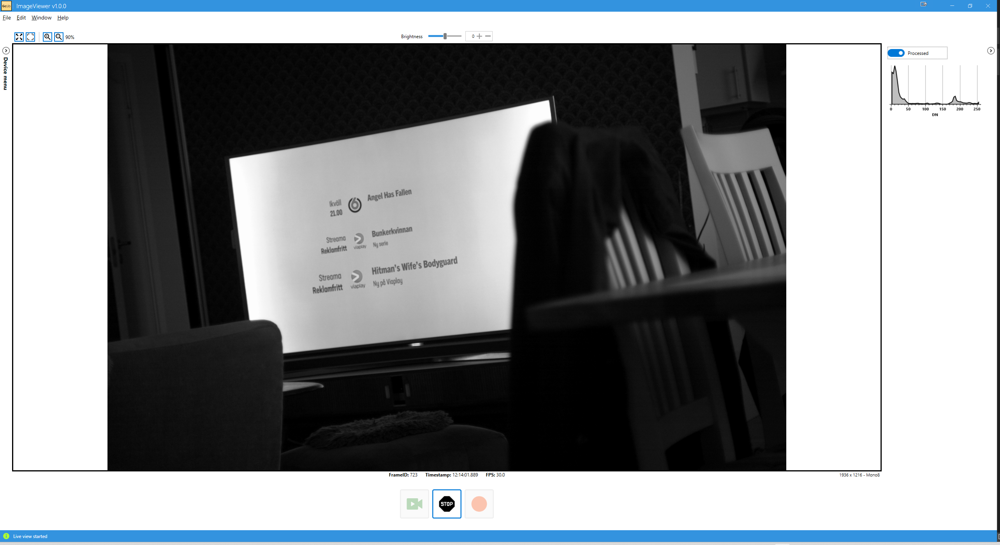

# GcLib

GcLib is a .NET library that provides a common interface to control settings and streaming of [GenICam/GenTL](https://www.emva.org/standards-technology/genicam/) cameras. The library wraps supported provider APIs, hiding their specific implementations so that applications can use a consistent interface across camera vendors.

## Supported camera APIs

The following provider SDKs and versionsare currently integrated in the repository:

| Provider | SDK | Integrated version |
| --- | --- | --- |
| [Pleora](https://www.pleora.com/machine-vision-connectivity/ebus-sdk/) | eBUS SDK | 6.4 |
| [Ximea](https://www.ximea.com/support/wiki/apis/xiAPINET) | xiAPI.NET | 4.33 |
| [Teledyne FLIR](https://www.teledynevisionsolutions.com/products/spinnaker-sdk/?model=Spinnaker%20SDK&vertical=machine%20vision&segment=iis) | Spinnaker SDK | 4.3 |
| [IDS](https://en.ids-imaging.com/ids-peak.html) | IDS Peak | 1.17 |
| [PCO](https://www.excelitas.com/product/pco-software-development-kits) | PCO SDK | 1.35 |
| [Basler](https://www.baslerweb.com/en/software/pylon/sdk/) | Pylon | 12.2 |
| [Allied Vision](https://www.alliedvision.com/en/support/software-downloads/vimba-x-sdk/vimba-x) | Vimba X | 1.3.4 |

These are the versions integrated in this repository, not a guarantee that every camera or SDK configuration has been tested. To use a physical camera, install the relevant provider SDK and camera drivers. Some providers may also require a separate license. Check the provider's documentation for its system requirements and terms; third-party SDKs and dependencies are subject to their own licenses.

## Requirements

- .NET 10 SDK.
- A 64-bit Windows environment for the included samples and bundled native provider libraries. Individual provider SDKs may have additional operating system, driver, or hardware requirements.

## Quick start

The following example initializes the library, discovers devices, changes parameters and acquires images. It is based on the [Console sample](samples/GcLib.Samples.ConsoleApp), where a library-included camera emulator ([VirtualCam](src/APIs/VirtualCam)) is used to demonstrate the workflow.

```csharp
using GcLib;

// Initialize the library, which discovers the APIs supported on the current system (always needed before the library can be used).
GcLibrary.Init();

// Instantiate the system level, from which devices can be opened (only one system level can be used at a time).
using var system = new GcSystem();

// Enumerate available devices.
system.UpdateDeviceList();
var cameraList = system.GetDeviceList();

// Open the first available device.
GcDevice camera = system.OpenDevice(cameraList[0]);

// Fetch a single image and save it to file (via Emgu.CV.Mat format).
camera.FetchImage(out GcBuffer image);
image.ToMat().Save("image1.tiff");

// Update some camera parameters.
camera.Parameters.SetParameterValue("Height", "480");
camera.Parameters.SetParameterValue("Width", "640");
camera.Parameters.SetParameterValue("PixelFormat", "RGB8");
camera.Parameters.SetParameterValue("TestPattern", "FrameCounter");

// Open a datastream to allow continuous acquisition and start streaming.
GcDataStream dataStream = camera.OpenDataStream();
dataStream.Start();

// Allow at least one image to be queued up, then retrieve it from the front of the queue.
Thread.Sleep(100);
dataStream.RetrieveImage(out image);
image.ToMat().Save("image2.tiff");

// Close the camera (this also stops all streaming) and the library.
camera.Close();
GcLibrary.Close();
```

## Samples

- [Console app](samples/GcLib.Samples.ConsoleApp) — a minimal example of discovery, parameter access, and image acquisition.
- [WinForms app](samples/GcLib.Samples.WinFormsDemoApp) — a lightweight graphical demo.
- [WPF app](samples/GcLib.Samples.WPFDemoApp) — a more complete demo for discovering devices, changing parameters, viewing live streams, and basic recording and playback.



## Contributing

Contributions are welcome. See the [contribution guide](CONTRIBUTING.md) for project guidance. Before adding or distributing third-party binaries, check that their licenses allow it.

## License

GcLib is licensed under the GNU General Public License, version 3. See [LICENSE.md](LICENSE.md) for the full license text. Third-party SDKs and dependencies may have separate license terms.
